<picture>
  <source media="(prefers-color-scheme: dark)" srcset="banner-dark.svg">
  
</picture>

Software engineer in Yerevan, Armenia. I build the whole thing: frontend,
backend, and whatever else it needs. Python is my first choice, Rust when
something has to be fast, and these days I write in far more languages than
those two. One of them is my own: I make [Ferron](https://ferron-lang.dev), a
programming language.

## How I work

Most of my code is now written together with AI agents, often several at once.
That changed what one person can take on: a database engine, a programming
language, a desktop bar, each in whatever language fits it. The typing got
cheap. Knowing what to build, and telling a good answer from a plausible one,
did not, and that is the part I enjoy.

## Now

_Updated: November 2026_

- [Ferron](https://ferron-lang.dev) is the biggest thing I have made: a
  statically typed language compiled to native code, with errors as values, no
  null, and no borrow checker. I designed it on paper for more than a year
  before the first commit. Its compiler is now written in Ferron and runs in
  the browser: try the [playground](https://ferron-lang.dev/playground) or the
  [tour](https://ferron-lang.dev/tour).
- At work I build services end to end. FastAPI over Postgres is how I ship a
  backend, and the problem I keep coming back to is finding things in messy
  documents: PDFs and Word files that nobody planned for.
- [`stellardb`](https://github.com/vadim-su/stellardb) is where the search
  ideas go when they need an engine: documents, graphs, vectors, and full-text
  search in one database, in Rust.
- Editor support for languages that have none yet: Mojo, and now Ferron.
- My desktop is Omarchy, and its bar is slowly becoming mine. The widgets are
  below.

## Projects

| Project | What it is | Status |
| --- | --- | --- |
| [Ferron](https://ferron-lang.dev) | A programming language: compiler, standard library, package manager, language server | alpha, source opening soon |
| [`stellardb`](https://github.com/vadim-su/stellardb) | Multi-model database in Rust: documents, graphs, vectors, full-text search | active |
| [`asyncord`](https://github.com/vadim-su/asyncord) | Async Discord API library for Python | maintenance mode, contributors welcome |
| [`fbenum`](https://github.com/vadim-su/fbenum) | Fallback enums for Python, pydantic-compatible | stable |
| [`zed_mojo`](https://github.com/vadim-su/zed_mojo) / [`tree-sitter-mojo`](https://github.com/vadim-su/tree-sitter-mojo) | Editor support for the Mojo language | active |
| [`ferron_zed`](https://github.com/vadim-su/ferron_zed) / [`tree-sitter-ferron`](https://github.com/ferron-lang/tree-sitter-ferron) | The same for Ferron | active |
| [`omarchy-pomodoro-bomb`](https://github.com/vadim-su/omarchy-pomodoro-bomb) | A pomodoro timer for the Omarchy bar, shaped like a ticking bomb | active |
| [`omarchy-monitor-workspaces`](https://github.com/vadim-su/omarchy-monitor-workspaces) | Workspace indicators grouped per monitor | active |
| [`omarchy-tuxedo-control`](https://github.com/vadim-su/omarchy-tuxedo-control) | Charge limit, CPU profile, and fan curves for TUXEDO laptops, in the bar | active |
| [`omarchy-abyssal-theme`](https://github.com/vadim-su/omarchy-abyssal-theme) | A deep-sea theme for Omarchy | active |

## Tech

- **Languages:** Python · Rust · Go · QML, and whatever the task asks for
- **Around them:** FastAPI, Postgres, Elasticsearch, LLVM, WebAssembly, Docker, QML/Quickshell
- **Interests:** APIs, search, automation, language design, AI agents

## Setup

Omarchy (Arch + Hyprland) · Zed · a bar I keep modifying · far too many keyboards.

## Elsewhere

- Ferron: [ferron-lang.dev](https://ferron-lang.dev)
- GitHub: [@vadim-su](https://github.com/vadim-su)
- LinkedIn: [vadim-su](https://linkedin.com/in/vadim-su)
